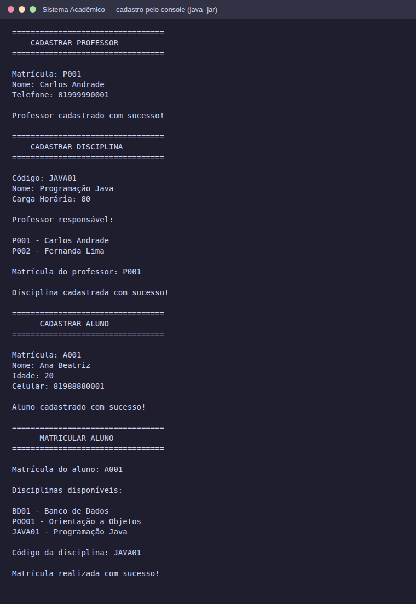
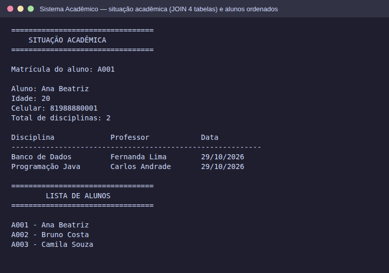
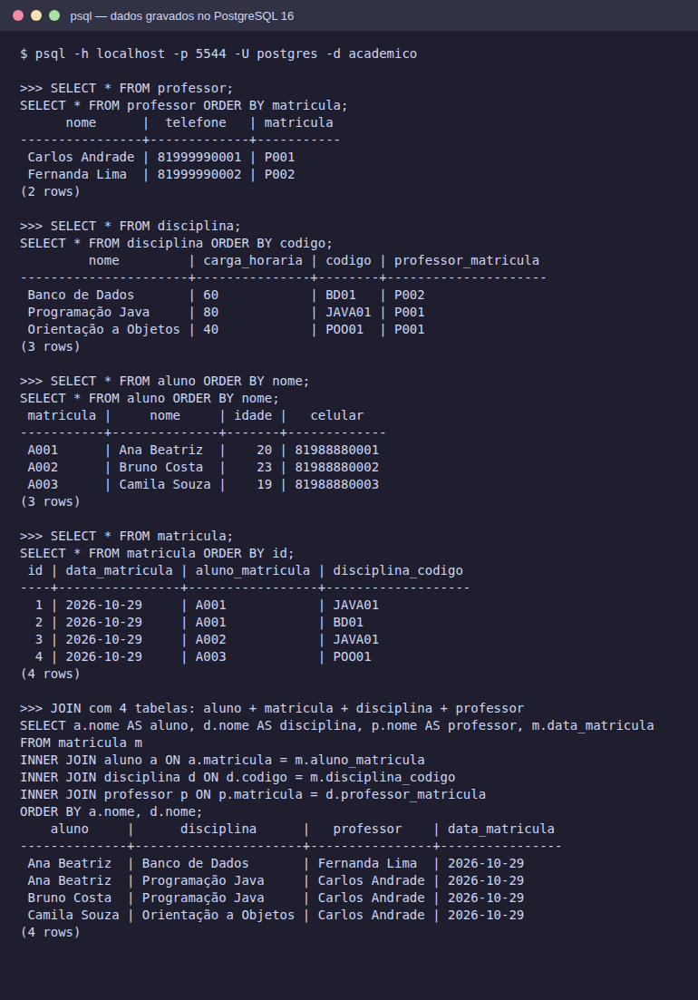

# Evidências do funcionamento no banco de dados

Os dados de exemplo foram cadastrados **pelo próprio sistema** (menus do console, `java -jar`), num banco PostgreSQL 16 vazio. Depois, numa conexão separada com o `psql`, os dados foram consultados direto nas tabelas para provar que ficaram gravados.

- Banco: PostgreSQL 16.15, `localhost`, banco `academico`
- Data: 29/10/2026
- Dados cadastrados: 2 professores, 3 disciplinas, 3 alunos e 4 matrículas (os mesmos do [`database.sql`](../database.sql))

## 1. Cadastro pelo sistema

Professor, disciplina (vinculada ao professor), aluno e matrícula cadastrados pelos menus:

## 2. Consultas no sistema

Situação acadêmica da aluna (JOIN entre `matricula`, `aluno`, `disciplina` e `professor`) e lista de alunos ordenada por nome:

## 3. Dados gravados no PostgreSQL

`SELECT` em cada tabela e o JOIN com 4 tabelas, executados direto no banco:

## Arquivos completos

- [`01-cadastro-pelo-sistema.txt`](01-cadastro-pelo-sistema.txt): a sessão inteira no console, com tudo o que foi digitado em cada menu
- [`02-dados-no-banco.txt`](02-dados-no-banco.txt): saída completa do `psql`, incluindo a versão do PostgreSQL, a lista de tabelas e as chaves estrangeiras
